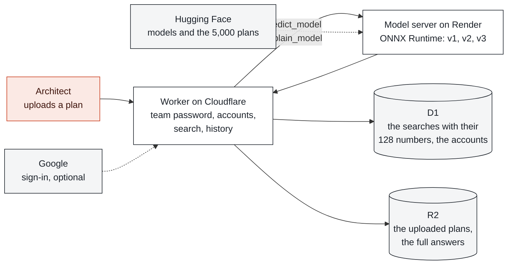

<h1 align="center">Plan precedents</h1>

Team 6: floor-plan similarity search 
Chloe Hraibeh, Jeff El Khoury, Luca Obejdeanu 
AI Methods I, hackathon, IAAC MaAI 2026/27 (16 to 20 November 2026)

An architect starting a housing project looks for precedents: homes whose plan looks like the one on their desk. Upload a floor plan, get the five most similar homes out of the 5,000 of CubiCasa5K, with their rooms, and see what the network computed to find them.

**[Open the app](https://hackathon-team6-cubicasa-app.hackathon-team6-cubicasa-app.workers.dev)** · [model server](https://hackathon-team6-cubicasa.onrender.com) · [model on Hugging Face](https://huggingface.co/iaac-maai/hackathon-team6-cubicasa-ae)

## The idea

Behind it there's a convolutional autoencoder that squeezes every plan into a code of 128 numbers. Plans with a similar layout get codes that are close to each other, so finding similar plans means finding the closest codes.

All 5,000 plans placed on a map by their codes and drawn as their rooms. Our first model compared how plans are drawn, the second the cleaned lines. The third, built on Chloe's notebook, learned to draw the rooms from the lines, so its neighbours are closer as homes: 34% of them have the same number of bedrooms, against 28% for the second model and 21% for random plans. The details are in [`01_autoencoder/`](01_autoencoder/).

Chloe also tried batch normalization and a fourth version trained on drawings aligned with their annotations. Her validation results and how to run it are in the [aligned model workflow](01_autoencoder/README.md#aligned-layout-model-v4); the app stays on v3.

## The app

You choose one of the three networks and upload a plan. Your plan and the five closest homes come back on sheets side by side, each drawing next to its rooms; the room key keeps only one room type on every map. Below them, Look inside shows what the network computed: where your plan lands among the 5,000, how close the five are against all the others, and what each layer sees. All of it comes from the same ONNX file the server runs.

## Your own account

The team password comes first; we give it in the course hand-in. Then you sign in to your own account, made with an email and a password or with Google. When you create one, the terms and conditions open, and nothing is saved until you tick "I agree". From then on your searches belong to your account: nobody else sees your plans, your results or your saved searches, and "Delete my account" at the bottom of the page removes all of it, from D1 and from R2.

The [guide](https://hackathon-team6-cubicasa-app.hackathon-team6-cubicasa-app.workers.dev/guide), the [features](https://hackathon-team6-cubicasa-app.hackathon-team6-cubicasa-app.workers.dev/features), the [FAQ](https://hackathon-team6-cubicasa-app.hackathon-team6-cubicasa-app.workers.dev/faq), the [terms](https://hackathon-team6-cubicasa-app.hackathon-team6-cubicasa-app.workers.dev/terms) and the [privacy policy](https://hackathon-team6-cubicasa-app.hackathon-team6-cubicasa-app.workers.dev/privacy) are open to everyone, linked at the bottom of every page.

## How it works

The page never talks to the model: the Worker checks the team password and the user's account (with [Better Auth](https://www.better-auth.com), its tables in D1), asks the server on Render, and keeps every search in D1 and R2, so a past search opens again while the free server sleeps. The 128 numbers of each upload stay in D1 and the Worker compares them itself, to find earlier uploads like this one. The details are in [`03_app/`](03_app/) and [`02_model_server/`](02_model_server/).

## Live parts

| Part | Link | Day |
|---|---|---|
| Model on Hugging Face | https://huggingface.co/iaac-maai/hackathon-team6-cubicasa-ae | Monday |
| Model server (Render) | https://hackathon-team6-cubicasa.onrender.com | Tuesday |
| App, first version (Cloudflare Pages) | https://hackathon-team6-cubicasa-app.pages.dev | Wednesday |
| App, React on Workers with Look inside | https://hackathon-team6-cubicasa-app.hackathon-team6-cubicasa-app.workers.dev | Wednesday |
| Accounts, Google sign-in, terms, privacy policy, guide and FAQ | the same app | Thursday |

## Repository

| Folder | What's in it |
|---|---|
| [`01_autoencoder/`](01_autoencoder/) | Monday: the data preparation, the notebook with three setups, the ONNX model, the model card and the slides. Tuesday: version 2 of the model, trained on cleaned plans (section 6 of the notebook), and version 3, which reads the rooms (`notebook/internal_layout_v3.ipynb`, by Chloe) |
| [`02_model_server/`](02_model_server/) | Tuesday: the model server (Gradio and ONNX Runtime on Render), its API and a notebook that calls it. Wednesday: `/predict_model`, to choose the network, and `/explain_model`, what every layer computes for one plan |
| [`03_app/`](03_app/) | Wednesday: the app on Cloudflare, a React page and a Worker that calls the model server, D1 for the searches and R2 for the plans. Look inside shows what the network computed: where the plan lands among the 5,000, how close the five matches are, what each layer sees. Thursday: user accounts behind the team password, with Google sign-in, the terms and the privacy policy, a guide, a FAQ and a logo. Our user stories and diagrams are in `03_app/diagrams/` |
| [`docs/images/`](docs/images/) | The images of this README: the logo, the animation at the top, drawn by `make_hero.py` from the v3 model and the 5,000 plans, the steps of the sign-in, drawn by `make_locks.py`, and the app in six screens |

## Dataset

[CubiCasa5K](https://zenodo.org/records/2613548): 5,000 floor-plan images, mostly of Finnish homes. Kalervo et al. (2019), SCIA. The dataset is CC BY-NC 4.0. [CubiCasa5K licence](https://github.com/CubiCasa/CubiCasa5k/blob/master/LICENSE). The data isn't in this repository.

## AI usage

| | |
|---|---|
| Tools | Claude Code (agent) |
| Why | to get going fast on a dataset and a kind of model that were new for us, and for the first drafts of the texts |
| Where | Monday: the comparison of datasets, the data preparation, the notebook code (adapted from the class notebook), the plots, the texts, the model card and the slides. Tuesday: version 2 of the model, the model part of Chloe's notebook for version 3, the server code (adapted from the class example `model_app/`), its README and `call_api.ipynb`. Wednesday: moving Jeff's first version of the app to React on Workers, the Look inside view and the `/explain_model` endpoint behind it, the script for the map data, the texts of `03_app/README.md` and the images of this README, drawn from the model's own output (`docs/images/make_hero.py`) and from screenshots of the app. Thursday: the user accounts (Better Auth inside the Worker, Google sign-in), the first drafts of the terms and conditions, the privacy policy and the guide, features and FAQ pages, the logo and the two new animations of this README |
| How | we went through several datasets of the course list with it (HVAC faults, weld radiographs, 3D printing, ResPlan) before choosing CubiCasa5K. We asked it to follow the class notebook and to train the three setups on the same split and seed. Then we ran the notebook again on our laptop and checked every number in the texts against the outputs. For the server we checked that each example plan finds itself first, at the same distance as in the notebook, so the server prepares the images the same way. For the app we compared four looks on the running page and chose one, and we checked the figures against the model: the distance of each match against `/predict_model`, the layer sizes and weights against the ONNX file. For the accounts we checked with two test accounts that one never sees the searches, plans or results of the other and that deleting an account removes its rows in D1 and its files in R2, then signed in with Google on the live app. The terms and the privacy policy describe what the code stores; they are written for a course project and were not checked by a lawyer |

Lessons learned: in two separate first tries we trained with MSE, like in class, and most of the models only learned to draw a blank page. Only 6.5% of the pixels are lines, so a blank page is already 95% right and the error looked fine. You have to look at the reconstructions, and compare the error with a dumb baseline like the blank page, not only read the number.

## Licence

MIT for the code, see [LICENSE](LICENSE). CubiCasa5K is CC BY-NC 4.0. [CubiCasa5K licence](https://github.com/CubiCasa/CubiCasa5k/blob/master/LICENSE).
